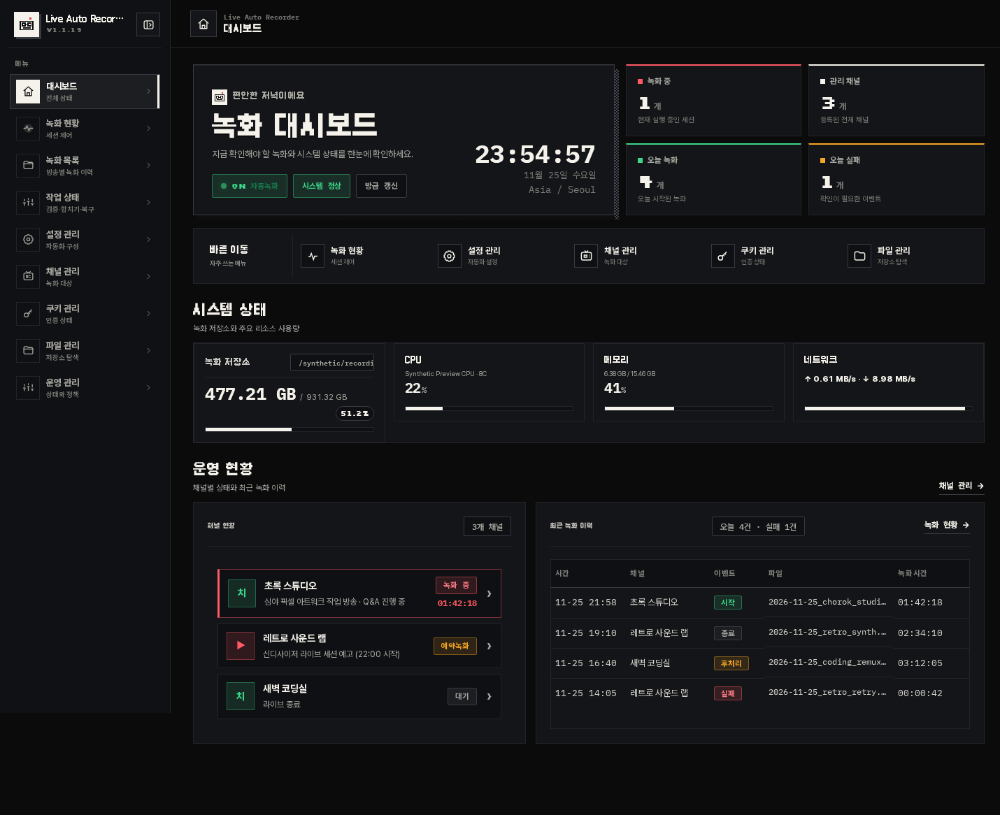
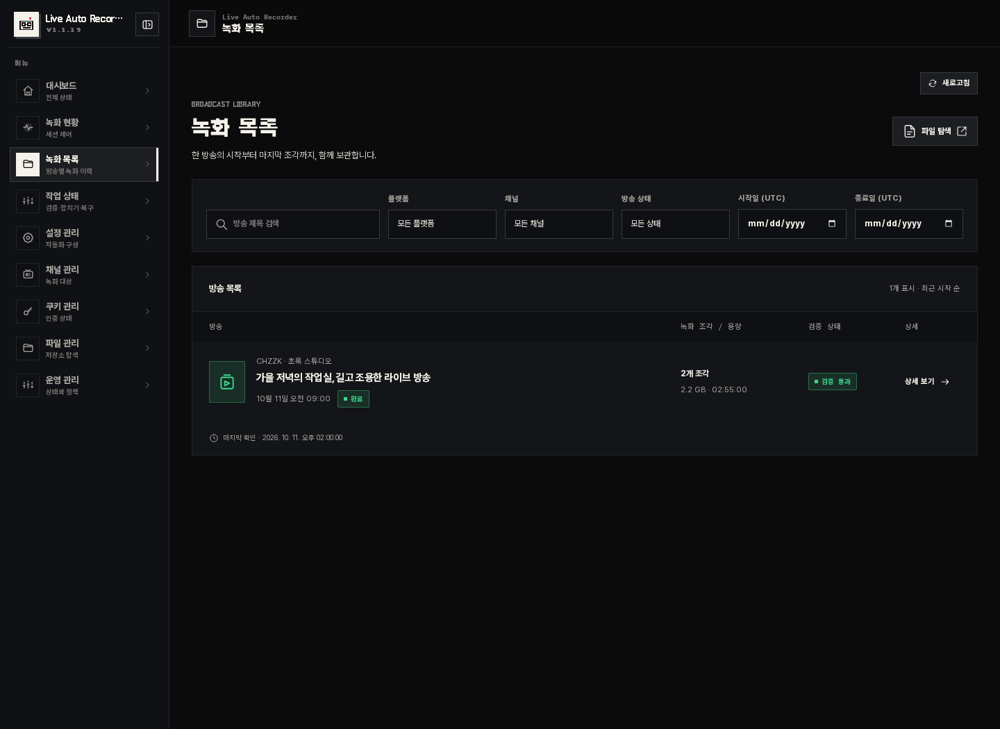

<div align="center">


# Live Auto Recorder

**CHZZK · YouTube 라이브를 자동으로 감지해 녹화하고, 웹 콘솔에서 한눈에 보관·관리하는 셀프 호스팅 도구**

개인 서버·홈서버·NAS에 Docker로 올려 두고, 다크 픽셀 대시보드에서 채널 상태와 녹화 파일을 편하게 확인하세요.

[](https://hub.docker.com/r/yeowoonlee/live-auto-recorder)
[](LICENSE)

[빠른 시작](#빠른-시작) · [화면 미리보기](#화면-미리보기) · [지원 기능](#현재-대시보드가-지원하는-기능) · [설정과 보안](#설정과-보안) · [문제 해결](#문제-해결) · [운영 가이드](docs/OPERATIONS.md)

</div>

---

## 화면 미리보기

### 녹화 대시보드 (`/`)

녹화 중인 세션, 관리 채널, 오늘 녹화·실패 현황, 저장소·시스템 리소스, 최근 녹화 이력을 한 화면에서 확인합니다.



<sub>※ 위 이미지는 실제 화면 구성을 보여주기 위해 예시(픽스처) 데이터로 촬영한 대시보드입니다.</sub>

### 녹화 목록 (`/broadcasts`)

재연결로 나뉜 파일도 방송 단위로 묶어 조회하고, 플랫폼·채널·상태·기간으로 검색하거나 검증 상태를 확인할 수 있습니다.



<sub>※ 예시(픽스처) 데이터로 촬영한 방송별 녹화 목록 화면입니다.</sub>

---

## 빠른 시작

Docker와 Docker Compose가 설치된 환경에서 바로 시작할 수 있습니다. (멀티 아키텍처 이미지 `linux/amd64`, `linux/arm64` 지원)

```bash
git clone https://github.com/hibye-ai/Live_auto_recorder.git
cd Live_auto_recorder
cp .env.example .env
mkdir -p data recordings logs tmp

docker compose pull
docker compose up -d
```

컨테이너가 올라오면 브라우저에서 아래 주소로 접속합니다.

```text
http://127.0.0.1:5000
```

> 기본 `compose.yaml`은 관리 화면을 `127.0.0.1`에만 바인딩합니다. 로컬 전용 모드에서는 별도 로그인 없이 바로 대시보드에 들어갈 수 있습니다.

### 처음 사용하는 CHZZK 셀프 호스팅 순서

1. **채널 등록** — 왼쪽 메뉴의 **채널 관리**(`/channels`)에서 녹화할 CHZZK(또는 YouTube) 채널을 추가하고 자동 녹화를 켭니다.
2. **쿠키 설정(필요 시)** — 성인 인증·구독자 전용 등 로그인이 필요한 방송은 **쿠키 관리**(`/cookies`)에서 쿠키를 등록합니다.
3. **녹화·알림 옵션 확인** — **설정 관리**(`/config`)에서 화질, 파일 형식, 저장 경로, Telegram/Discord 알림을 원하는 대로 맞춥니다.
4. **상태 확인과 제어** — **대시보드**(`/`)와 **녹화 현황**(`/recording`)에서 진행 중인 세션을 확인하고 수동 녹화 시작·중지도 실행할 수 있습니다.

<details>
<summary>소스 코드로 직접 실행하기 (개발·로컬 실행)</summary>

Docker 이미지에는 웹 보관함 정적 번들과 `ffmpeg`, `rclone`, `ytarchive` 등이 포함되어 있습니다. 소스에서 직접 실행할 때는 Python 의존성 설치와 프런트엔드 빌드가 필요합니다.

```bash
python -m pip install -r requirements.txt
cd frontend && npm ci && npm run build
cd ..
python app_entry.py
```

`app_entry.py` 단독 실행도 기본값은 `127.0.0.1:5000`입니다. 자세한 개발·테스트 방법은 [기여 방법](.github/CONTRIBUTING.md)을 참고하세요.

</details>

---

## 현재 대시보드가 지원하는 기능

| 영역 | 주요 화면 | 지원하는 기능 |
|---|---|---|
| **자동 감지·녹화** | `/`, `/recording`, `/channels` | CHZZK / YouTube 라이브 자동 감지 및 녹화, 채널별 자동 녹화 설정, 수동 시작·중지, 화질·파일 형식·저장 경로 옵션 |
| **채널별 녹화 규칙** | `/channels` | 제목 포함·제외 키워드, 허용 카테고리, 요일·시간대, 시작 지연, 화질 덮어쓰기, 최대 녹화 시간, 최소 시간 미달 파일 자동 삭제 |
| **녹화 목록·파일 탐색** | `/broadcasts`, `/files` | 방송 단위 녹화 이력 검색·필터, 세그먼트·용량·검증 상태 확인, 읽기 전용·휴지통·접근 범위가 보호된 파일 탐색기 |
| **안정성·복구** | `/operations`, `/jobs` | 10초 주기 녹화 상태 감시, 120초 정체 감지 및 제한된 자동 재연결(기본 최대 3회), `ffprobe` 완료 파일 검증 및 FFmpeg stream-copy remux 자동 복구, 방송 세그먼트 수동 합치기 |
| **저장소·외부 보관** | `/operations` | 남은 공간 10% 경고 / 5% 신규 녹화 차단, 미리보기 기반 안전 정리, `rclone`을 이용한 외부 스토리지 자동 보관 |
| **알림·운영·자동화** | `/config`, `/cookies`, `/operations` | Telegram / Discord / HMAC-SHA256 웹훅 알림, 설정 백업·복원 및 SQLite 자동 스냅샷, 쿠키·도구·DB 시스템 점검, `lar_` Bearer 토큰 기반 자동화 API |

### 화면 구성과 영속 엔진(`LAR_V2_ENABLED`) 안내

- 기존 v1 콘솔(`/`, `/recording`, `/config`, `/channels`, `/cookies`, `/files`, `/operations`)과 같은 메뉴·다크 디자인 안에 **녹화 목록**(`/broadcasts`)과 **작업 상태**(`/jobs`)가 통합되어 있습니다. 별도 v2 화면은 제거되었으며 이전 `/v2` 경로는 해당 콘솔 화면으로 연결됩니다.
- **녹화 목록**은 기존 녹화 이력을 그대로 조회합니다. 화면을 여는 것만으로 데이터 이전이나 엔진 전환을 수행하지 않습니다.
- 기본값 `LAR_V2_ENABLED=false`에서는 기존 녹화 엔진을 유지합니다. 이때 **작업 상태**(`/jobs`)의 영속 작업 큐 요청(검증·합치기·복구)은 비활성으로 표시되며, 기존 후처리 작업은 **운영 관리**(`/operations`)에서 확인할 수 있습니다.
- 영속 엔진은 로컬 SQLite와 확인된 스토리지 마커(`.lar-storage-id`)가 필요한 선택형 프리뷰 기능입니다. 안전 검증을 마치기 전까지 `false`로 유지하고, 사용 조건과 롤백 절차는 [영속 엔진 안내](docs/v2/README.md)를 먼저 확인하세요.

---

## 설정과 보안

주요 이미지·포트·경로·동작 옵션은 `.env`에서 조정합니다. `compose.yaml`은 아래 변수를 컨테이너로 전달합니다.

| 변수 | 기본값 | 설명 |
|---|---|---|
| `LIVE_AUTO_RECORDER_IMAGE` | `yeowoonlee/live-auto-recorder:latest` | 사용할 Docker 이미지 (`main` CI 통과 시 `latest` 및 롤백용 `sha-<커밋SHA>` 게시, `v*` 버전 태그는 별도 Git 태그 push 시 게시) |
| `APP_PORT` | `5000` | 호스트 `127.0.0.1`에 바인딩할 웹 포트 (컨테이너 내부 `5000`) |
| `TZ` | `Asia/Seoul` | 컨테이너 시간대 |
| `LOG_LEVEL` | `info` | 서버 로그 수준 (`critical`, `error`, `warning`, `info`, `debug`, `trace`) |
| `ALLOW_SECRET_BACKUPS` | `false` | `true`일 때만 쿠키·토큰·웹훅 등 민감정보 포함 백업 허용 |
| `CONFIG_PATH` | `./data` | 컨테이너 `/app/json` 마운트 (설정, 채널, SQLite 카탈로그, `rclone.conf`, 감사 로그) |
| `RECORDINGS_PATH` | `./recordings` | 컨테이너 `/app/chzzk` 마운트 (녹화 영상 저장 경로) |
| `LOG_PATH` | `./logs` | 컨테이너 `/app/logs` 마운트 |
| `TMP_PATH` | `./tmp` | 컨테이너 `/app/tmp` 마운트 |
| `LAR_ALLOWED_HOSTS` | `localhost,127.0.0.1,::1` | 보호된 원격 접속 시 허용할 호스트명 목록 (쉼표 구분) |
| `LAR_V2_ENABLED` | `false` | 선택형 영속 엔진 활성화 여부 (기본 `false` 유지 권장) |

`.env`를 수정한 뒤에는 컨테이너를 재생성해야 변경 사항이 반영됩니다.

```bash
docker compose up -d --force-recreate
```

채널 등록, 쿠키, 녹화 옵션, 알림 같은 대부분의 설정은 웹 관리 화면에서도 변경할 수 있습니다.

### 인증과 보안 원칙

- **루프백 기본 바인딩**: 기본 배포는 `127.0.0.1`에만 포트를 엽니다. 애플리케이션 포트를 LAN이나 인터넷에 직접 노출하지 마세요.
- **원격 접속**: 외부에서 접속해야 한다면 인증이 적용된 리버스 프록시 또는 VPN 뒤에 두고, 필요 시 `LAR_ALLOWED_HOSTS`에 접속 호스트명을 명시하세요.
- **자동화 API 토큰**: 웹 콘솔이 로컬 전용으로 열려 있더라도 `/api/v3/automation/*` 엔드포인트는 운영 관리에서 발급한 `lar_` Bearer 토큰을 요구합니다.
- **민감정보 보호**: 기본 백업과 설정 JSON 내보내기는 쿠키·토큰·웹훅을 제외합니다. 취약점 제보는 공개 이슈가 아닌 [보안 안내](SECURITY.md)를 따라 주세요.

---

## 업데이트와 데이터 보존

업데이트 전에는 호스트의 `data` 디렉터리(설정, `recordings.sqlite3`, `rclone.conf` 등)와 중요한 녹화 파일을 백업해 두는 것을 권장합니다. 롤백이 필요할 수 있다면 현재 실행 중인 이미지 digest 또는 `sha-<SHA>` 태그를 미리 기록해 두세요.

```bash
git pull --ff-only
docker compose pull
docker compose up -d --force-recreate
```

이상이 발생하면 `.env`의 `LIVE_AUTO_RECORDER_IMAGE`를 이전 `sha-<SHA>` 태그나 digest로 지정한 뒤 `docker compose up -d --force-recreate`로 되돌릴 수 있습니다. 자세한 절차는 [릴리스 절차](docs/RELEASE.md)와 [운영 가이드](docs/OPERATIONS.md)를 참고하세요.

---

## 문제 해결

- **컨테이너 상태와 로그 확인**:
  ```bash
  docker compose ps
  docker compose logs -f recorder
  ```
  컨테이너 헬스체크는 `http://127.0.0.1:5000/readyz`를 확인합니다.
- **환경 점검**: **운영 관리**(`/operations`)의 **시스템 점검** 탭에서 `ffmpeg`/`Streamlink`/`ytarchive`/`rclone`, 저장소 쓰기 권한과 남은 공간, SQLite 무결성, 쿠키 상태, CHZZK/YouTube HTTPS 연결을 한 번에 점검할 수 있습니다.
- **성인·구독 방송 녹화 실패**: **쿠키 관리**(`/cookies`)에서 CHZZK/YouTube 쿠키가 만료되거나 누락되지 않았는지 확인하고 다시 등록하세요.
- **신규 녹화가 시작되지 않음**: 저장소 여유 공간이 5% 미만이면 신규 녹화가 자동 차단됩니다. 여유 공간과 채널별 녹화 규칙(제목·카테고리·요일·시간대)을 확인하세요.
- **작업 상태(`/jobs`)의 버튼이 비활성임**: 기본값 `LAR_V2_ENABLED=false`에서는 정상 동작입니다. 기존 후처리 작업과 수동 검증·합치기는 **운영 관리**(`/operations`)에서 확인하세요.
- **`.env` 변경이 적용되지 않음**: `docker compose restart` 대신 `docker compose up -d --force-recreate`로 컨테이너를 재생성하세요.

---

## 문서와 기여

세부 운영 기능, 내부 구조, 릴리스 및 기여 규칙은 아래 문서에 정리되어 있습니다.

- [운영 가이드](docs/OPERATIONS.md) — 저장소 보호, 검증·복구·합치기, 알림, `rclone`, 자동화 API, 백업·복원
- [프로젝트 구조](docs/ARCHITECTURE.md) — 디렉터리 책임과 의존성 경계
- [영속 엔진 안내](docs/v2/README.md) — 선택형 영속 엔진 조건, 스토리지 마커, 롤백 절차
- [릴리스 절차](docs/RELEASE.md) — 버전 관리(`VERSION`), Conventional Commits, Docker 게시 규칙
- [보안 안내](SECURITY.md) — 지원 범위와 취약점 제보 방법
- [기여 방법](.github/CONTRIBUTING.md) — 로컬 개발 환경, 필수 회귀 검사, PR 규칙
- [변경 내역](CHANGELOG.md) — 버전별 변경 기록

## 라이선스

[MIT License](LICENSE)

저장소에 포함된 일부 폰트와 프런트엔드 라이브러리는 별도 라이선스를 따릅니다. 자세한 내용은 [THIRD_PARTY_NOTICES.md](THIRD_PARTY_NOTICES.md)를 참고하세요.
